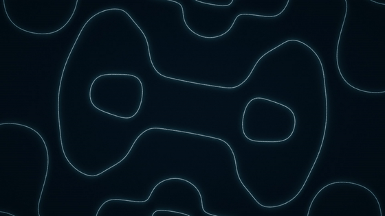

# FreqFlux

A minimalist, audio-reactive music visualizer. Drop in a song and watch every beat and note move through quiet, line-based visuals in real time in the browser, then optionally export the same look as a 1080p60 MP4.



[Watch the demo with sound (MP4)](docs/demo.mp4)

<!-- Add the demo track credit here, e.g. "Demo audio: <title> by <artist> (<license>)" -->

## Features

- **Real-time playback in the browser.** Upload a song, press play. Visuals are drawn live with WebGL2 and stay locked to the audio clock. No render-then-download step.
- **Motion tied to the music, not to loudness.** Kicks launch travelling ripples and push the pattern, mid-band hits and new notes add faster ripples, hi-hats make the lines shimmer, and the notes currently sounding shape the geometry.
- **Five scenes**, all thin lines on a dark ground: Resonance, Harmonic String, Ripple Orb, Aurora Veil, Soft Waves.
- **Palettes and controls.** Six muted palettes plus a four-colour custom palette, and sliders for motion, brightness, dynamics, bass, mids, treble, onset sensitivity and sync offset.
- **Microphone mode** for live visuals from the browser mic.
- **MP4 export** that matches the live view exactly: headless OpenGL frames piped to FFmpeg, with the original audio muxed in.

## Quick start

Tested on Ubuntu under WSL2. Needs Python 3.10+, FFmpeg, and OpenGL 3.3 (EGL) for the MP4 export. The live player needs only a browser with WebGL2.

```bash
git clone https://github.com/kartikeyy12/freqflux.git
cd freqflux

sudo apt update
sudo apt install -y python3-venv ffmpeg libsndfile1 libegl1 libgl1 libgl1-mesa-dri libglu1-mesa mesa-utils

python3 -m venv .venv
source .venv/bin/activate
pip install -r requirements.txt

python app.py
```

Open **http://localhost:7860**. Use `localhost` rather than the machine's IP, because browsers only allow microphone access on localhost or HTTPS. Options: `python app.py --host 0.0.0.0 --port 7860`.

The first start spends about 15 seconds warming up librosa's beat tracker in the background, so wait for the "FreqFlux is running" line before uploading.

## Using it

Drop an audio file (mp3, wav, flac, ogg, m4a, or anything else librosa can decode) onto the page, or choose **Use microphone**.

| Key | Action |
| --- | --- |
| Space | Play / pause (clicking the picture also toggles) |
| 1 to 5 | Switch scene |
| F | Fullscreen |
| M | Mute |
| L | Open the settings panel |
| Left / Right | Seek 5 s |

The controls auto-hide while playing. Move the mouse to bring them back.

**Sync.** The player compensates for the browser-reported audio output latency automatically. If the picture still feels early or late (Bluetooth speakers, for example), use the sync offset slider in the settings panel.

### Export a video

From the UI: open the settings panel, choose **Export as MP4 video**, pick resolution, frame rate and quality.

From the command line:

```bash
python video_exporter.py path/to/song.mp3 -o renders/out.mp4 \
    --scene "Resonance" --palette "Deep Ocean" \
    --width 1920 --height 1080 --fps 60 --crf 18
```

Useful flags: `--max-seconds 20` (render only the first 20 s), `--encoder h264_nvenc` (NVIDIA hardware encoding if your FFmpeg supports it), `--bass-gain`, `--mid-gain`, `--treble-gain`, `--onset-sensitivity`, `--contrast`, `--intensity`, `--motion`. The exporter prints a frame count and an audio/video end-offset check when it finishes.

### Other tools

```bash
python audio_dsp.py --selftest                      # frame-clock exactness and a synthetic-signal analysis check
python audio_dsp.py path/to/song.mp3                # quick analysis summary
python renderer.py --audio path/to/song.mp3 --frame 3000 --scene all   # render still frames of every scene
```

If headless OpenGL fails to start, try `LIBGL_ALWAYS_SOFTWARE=1`, run under `xvfb-run -a`, or set `FREQFLUX_GL_BACKEND` (for example to `egl`) to force a specific backend.

## Scenes

| Scene | What you see | What drives it |
| --- | --- | --- |
| **Resonance** | A vibrating plate in the tradition of Chladni figures: thin nodal lines that reshape with the music. | Each sounding note excites its own standing-wave figure and a chord is their sum. Every kick strikes the plate: a wave crosses it, bends the lines, and the plate turns a step. Loud passages draw the lines solid, quiet ones break them into sand grains. |
| **Harmonic String** | One line that is the sum of the sine waves of the notes playing, with a fading ribbon of trails. | Real musical frequency ratios, so consonant chords give clean repeating shapes and clashing notes make visible beating. Each kick plucks the string at the centre. Wave speed is locked to the tempo. |
| **Ripple Orb** | A soft orb with a ring of twelve pitch-class points. | Kicks and mid-band hits launch rings that travel outward. The sounding note lights its point on the ring. |
| **Aurora Veil** | Slow light curtains. | Horizontal position is frequency (bass left, treble right). Hits push the veil along and it sways with the beat. |
| **Soft Waves** | Seven stacked lines. | Each line is the spectrum from a moment ago, so a kick makes a bump that rolls back through the lines and every note is a peak at its own frequency. |

## How it works

```
 audio file ──► audio_dsp.py ──► per-frame features ──┬──► browser (WebGL2, live, synced to <audio>)
 (upload)       analysis @ 60 FPS                     │       shaders served by app.py from scenes.py
                                                      └──► renderer.py (ModernGL, headless)
                                                              raw RGB ──► FFmpeg ──► MP4 + original audio
```

**One source of truth for the look.** The GLSL shaders, palettes and per-frame motion logic live in `scenes.py`. The browser compiles them as GLSL ES 300 (WebGL2) and the exporter compiles them as GLSL 330 (ModernGL), so the live view and the exported video match. The small motion state machine is mirrored in `web/index.html`, and its constants are served from Python so both sides read the same numbers.

**Audio analysis** (`audio_dsp.py`, offline, 44.1 kHz):

- **Exact frame clock.** Video frame *i* maps to sample `floor(i * fs / fps)` computed in integer arithmetic with fps as a rational, so there is no accumulated drift over any track length, including 59.94 fps. The frame count is `ceil(n_samples * fps / fs)`.
- **Two FFT resolutions.** 4096 points (about 93 ms) for band energy, the log spectrum and pitch; 1024 points (about 23 ms) for onset detection so transients stay sharp.
- **Spectrum.** 48 log-spaced bands from 40 Hz to 12 kHz, normalized per band so a note appearing in a band lights that band.
- **Pitch classes.** A 12-bin chroma vector (110 Hz to 4 kHz) from the FFT, gated so silence shows nothing.
- **Events.** Half-wave rectified, log-compressed spectral flux in three frequency groups (20 to 250 Hz, 250 Hz to 4 kHz, 4 to 16 kHz), each peak-picked with an adaptive threshold and a 90 ms refractory period. These become the kick, mid-band and hi-hat streams.
- **Beat grid.** librosa's beat tracker runs on a kick-and-snare weighted onset envelope and is turned into a continuous beat position per frame, falling back to a steady 120 BPM grid when no stable beat is found.

**Export** (`video_exporter.py`): frames are rendered headlessly with ModernGL (EGL) and streamed as raw RGB24 to an FFmpeg subprocess through a queue and a writer thread, so rendering and encoding overlap. Output is H.264 yuv420p with full-to-limited range conversion and BT.709 tags, x264 `aq-mode=3` to keep dark gradients free of banding, and the original audio padded or trimmed to exactly `n_frames / fps`. Partial files are written to a `.part` file and removed on cancel or failure.

### Validation

The analysis was checked against a synthetic ground-truth track (120 BPM with known kicks, snares, hats and a melody of known notes): tempo detected as 120.0 BPM with the beat grid on the kicks, 47 of 48 kicks matched within 50 ms (median error 0 ms), and all 44 melody notes mapped to the correct pitch class. Exported files showed an audio/video end offset under 1 ms at 60, 59.94 and 24 fps.

## Project layout

```
app.py             FastAPI server: upload, background analysis, audio streaming, feature data, export jobs
audio_dsp.py       Analysis: frame clock, spectrum, chroma, events, beat tracking, live analyzer
scenes.py          Shaders, palettes and per-frame motion state (shared by browser and exporter)
renderer.py        Headless ModernGL renderer used for export
video_exporter.py  Render loop piped into FFmpeg, with progress, cancel and verification
web/index.html     The browser UI and WebGL2 player (single file, no build step)
docs/              Demo media
setup_wsl.sh       Convenience setup script for Ubuntu under WSL2
```

## Limitations

- Beat tracking assumes a fairly steady tempo. On rubato or beatless music the tempo-locked sway can drift, though kick ripples and note tracking still work from the actual audio.
- Pitch analysis is chroma based. Dense or noisy mixes give busier Resonance figures, and the Dynamics slider can calm them.
- Microphone mode uses simpler, causal versions of the same analysis (adaptive levels and an estimated tempo), so it is less precise than file playback.
- One export runs at a time. Export speed depends on the GPU. With software OpenGL it is much slower.

## Built by

Kartikey. [Portfolio](https://kartikeybuilds.vercel.app) · [GitHub](https://github.com/kartikeyy12)
